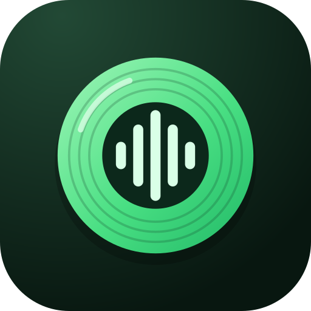
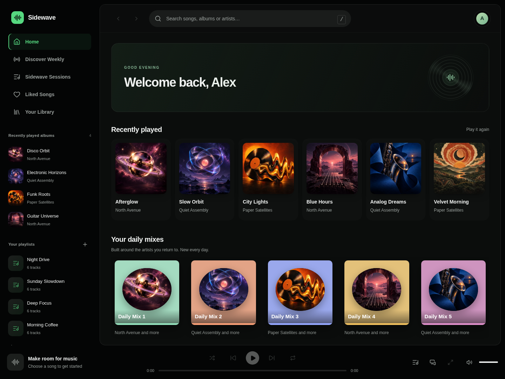

<p align="center">
  
</p>

<h1 align="center">Sidewave</h1>
<p align="center"><strong>Your music, your space.</strong></p>
<p align="center">A self-hosted music experience for the web, Android and Android Auto.</p>

Sidewave brings your library, listening history, playlists and discovery into one place. Run the server yourself, open the web app, or connect the native Android client. Built by Anıl Sargın at Sargın Labs.



[Watch the interface demo](docs/screenshots/demo.mp4) · [Daily mix](docs/screenshots/mix.png) · [Mobile web](docs/screenshots/mobile-web.png)

Screenshots and the silent demo use fictional tracks and bundled artwork. They show the actual UI; they are not live-playback evidence.

## What you can do

- **Listen across devices.** Web and native Android players, device handoff, queue controls and account-scoped libraries.
- **Bring your collection.** Connect a Navidrome library, import playlists and Spotify data exports, and review ambiguous matches before importing.
- **Find your next favourite.** Daily mixes, Discover Weekly, Sidewave Sessions, related artists and recommendations shaped by listening.
- **Take music with you.** Android downloads, notification and lock-screen controls, home-screen widgets, and Android Auto browsing.
- **Make it yours.** Synced lyrics, listening statistics, playlist sharing and collaboration, themes, and web crossfade.

This is the first public-source release. Provider-dependent features may stop working when upstream services change. Real-device Android Auto and long background-playback acceptance remain separate from the automated checks. No music collection or user data is included.

## Start with Docker

Requires Docker Engine and Docker Compose v2 or newer.

```sh
cp .env.example .env
mkdir -p library
docker compose up -d --build
```

Open **http://localhost:4444** and create an account. The first account owns this installation. Complete that step before making it publicly reachable.

The default setup starts the web app, API and internal catalog/resolver service. A local music library is optional. Catalog access and playback depend on the provider and network; a healthy server does not guarantee access to a specific recording.

### Connect your library

Put your own music in `library/`, then start the optional Navidrome service:

```sh
docker compose --profile library up -d
```

Open `http://localhost:4533`, create your Navidrome account and let the library scan. Set `NAVIDROME_USER` and `NAVIDROME_PASS` in `.env`, then run `docker compose up -d sidewave`. If you already have Navidrome, set `NAVIDROME_URL` to an address reachable from the Sidewave container instead.

See [self-hosting](docs/self-hosting.md) for HTTPS, storage, backups and optional integrations.

## Android

The native client requires **Android 10+**. Configure your own server at the login screen under **Connection settings**:

- A public server: `https://music.example.com`
- A local server: `http://YOUR_SERVER_LAN_IP:4444`

Sidewave has its own application ID, `com.sarginlabs.sidewave`. It installs separately from Sargın Music and does not inherit its accounts, downloads or signing identity.

```sh
cd sidewave/android
./gradlew :app:testDebugUnitTest :app:assembleDebug
```

Build requirements: JDK 17 and Android SDK 35. The resulting debug APK is under `app/build/outputs/apk/debug/`. [Android setup, signing and update publishing](sidewave/android/README.md).

## Development

Use Node.js 22 and Python 3.12 for the resolver.

```sh
cd sidewave
npm ci
npm test
npm run generate:models
cd web
npm ci
npm test
npm run build
```

Run the API with `npm start` from `sidewave/`. Run `npm run dev` from `sidewave/web/`; its API proxy defaults to `http://127.0.0.1:4444` and can be overridden with `SIDEWAVE_API_URL`.

```sh
cd ytres
python3 -m venv .venv
.venv/bin/pip install -r requirements-dev.txt
.venv/bin/python -m pytest -q
```

`sidewave/openapi.json` is the shared API contract. `npm run generate:models` updates the TypeScript and Kotlin models together. See [CONTRIBUTING.md](CONTRIBUTING.md) for checks and contribution scope.

## Project layout

| Directory | Purpose |
| --- | --- |
| `sidewave/` | Hono API, SQLite stores, contracts and backend tests |
| `sidewave/web/` | React / TypeScript web client |
| `sidewave/android/` | Kotlin / Compose / Media3 client |
| `ytres/` | Internal catalog and audio-resolution service |
| `sonic-online/` | Optional bounded audio-analysis worker |
| `beets/` | Optional library-ingestion helper |
| `docs/` | Self-hosting and release documentation |

## License and attribution

Original Sidewave code is available under the [MIT License](LICENSE). Bundled fonts, icons, dependencies and optional service images retain their own licenses; see [THIRD_PARTY_NOTICES.md](THIRD_PARTY_NOTICES.md).

Sidewave is an independent project by Sargın Labs. It is not affiliated with Spotify, YouTube, Google, Navidrome, or other products and artists using the Sidewave name.
