<p align="center">
  
</p>
<h1 align="center">Sidewave</h1>
<p align="center"><strong>Your music, your space. Find your next sound.</strong></p>
<p align="center">A self-hosted music player with sound discovery, a native Android app, and Android Auto browsing.</p>
<p align="center">
  <a href="#start-with-docker">Get started</a> ·
  <a href="#follow-the-sound">Sound discovery</a> ·
  <a href="#a-look-inside">Screenshots</a> ·
  <a href="https://github.com/anilsarginn/sidewave-music/releases">Downloads</a>
</p>


Sidewave brings your collection, online discoveries, playlists and listening history into a music space you host yourself. Start with a favourite track, find a new direction, and keep the discoveries that feel like you. Built by **Anıl Sargın at Sargın Labs**.

**[Watch the interface tour →](docs/screenshots/demo.mp4)**

## Follow the sound

There is more than one way to find the next track. Open **Sound discovery** from a song or directly from Now Playing:

| Start here | Where it takes you |
| --- | --- |
| **Similar tracks** | Explore nearby sounds and see which results come from audio comparison or catalog connections. |
| **Instant mix** | Build a queue around one recording, then play it, append it, or save it as a new playlist. |
| **Sound journey** | Choose a starting track and a destination. Move through a sequence of library recordings while keeping both endpoints. |
| **Similar artists** | Find artists through the sound of analyzed recordings in your library. |

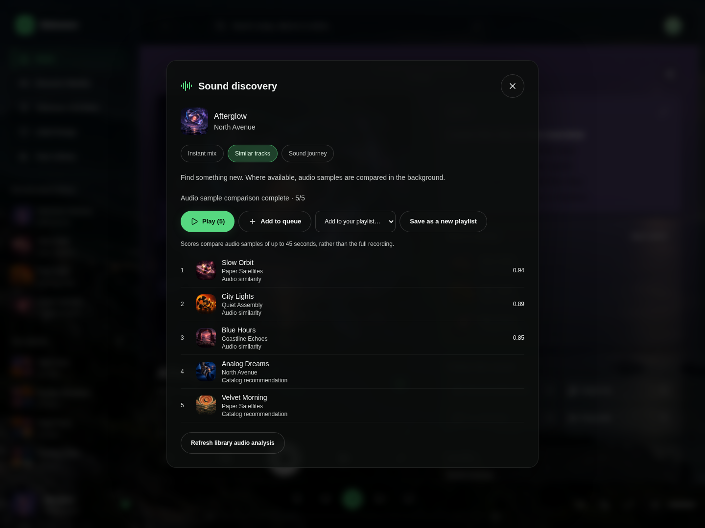

**Audio-aware discovery.** Catalog suggestions can appear first; with the optional online analysis worker, Sidewave compares audio excerpts of up to 45 seconds in the background. Results keep their provenance: **Audio similarity** and **Catalog recommendation** have separate labels. You can preview the list, add it to your queue, or save a playlist.

Online excerpt comparison requires the optional [`sonic-online` worker](sonic-online/README.md). Sound journey and library artist similarity require a configured library-analysis service and analyzed library recordings. Scores describe similarity between analyzed audio; they are not a prediction of personal taste. See [discovery setup](docs/self-hosting.md#optional-integrations).

## Keep finding something new

| Feature | What it adds to your day |
| --- | --- |
| **Daily Mixes** | Artist-centred mixes shaped by the music you return to, refreshed daily. |
| **Discover Weekly** | A personal weekly selection that stays with you until the next Monday. |
| **Sidewave Sessions** | Eight genre collections: Electronic Horizons, Jazz After Hours, Psychedelic Roots, Soul Colors, Disco Orbit, Slow Motion, Guitar Universe and Funk Roots. |
| **Smart Shuffle & song radio** | Add discoveries to a listening session or branch out from the current track. |
| **Rediscover** | Return to recordings from your own listening history. |
| **Likes, follows & feedback** | Keep songs and artists close, save albums, or tell Sidewave a recommendation is not for you. |

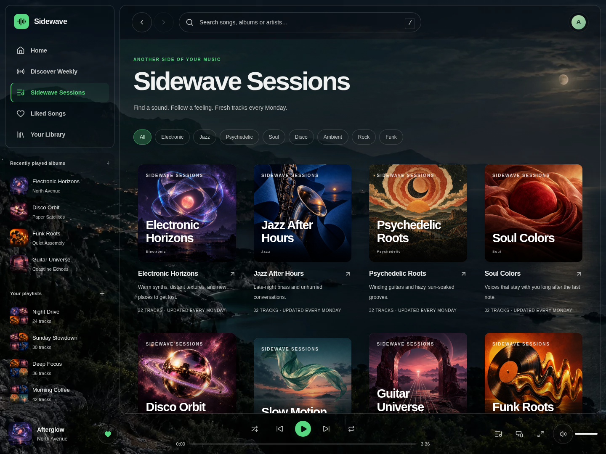

## Built for the whole listening session

- **A player you can settle into.** Now Playing with large cover art, synced lyrics, artist information, credits and the next songs in your queue. Web controls include crossfade, even volume and a sleep timer.
- **Your collection, connected.** Bring a Navidrome library alongside online catalog discovery. Import playlists or Spotify data exports, review uncertain matches, and keep listening history and statistics together.
- **Music worth sharing.** Share songs and playlists, follow shared selections, or let other members add to a collaborative playlist. Each account has its own library and history.
- **Your music on the move.** Native Android playback with completed offline downloads, lock-screen and notification controls, home-screen widgets, and Android Auto media browsing.
- **A room of your own.** Four signature backgrounds, your own photos, adjustable dimming and translucent panels. Appearance is saved per device, so your desktop and phone can have different moods.

## A look inside

### Welcome in

<table>
  <tr>
    <td width="50%">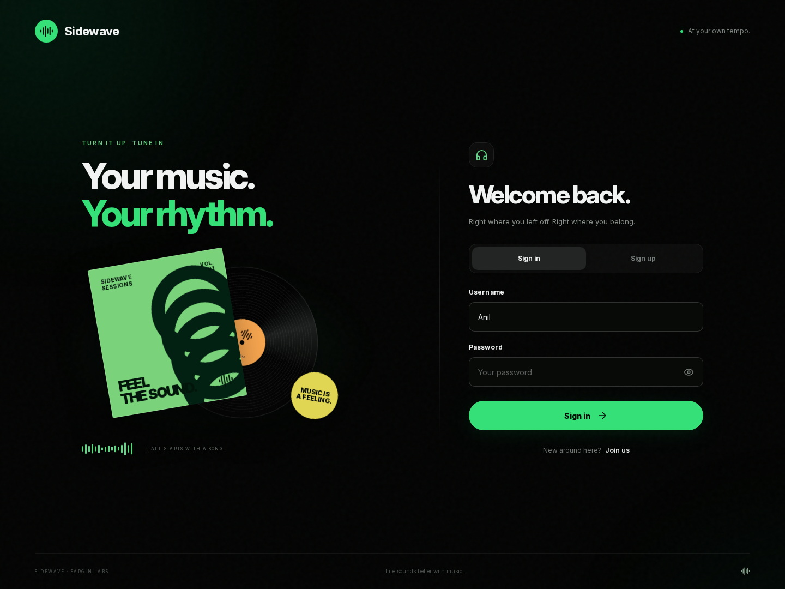<br><strong>Sign in</strong><br>A music-first welcome, with your account and library one step away.</td>
    <td width="50%">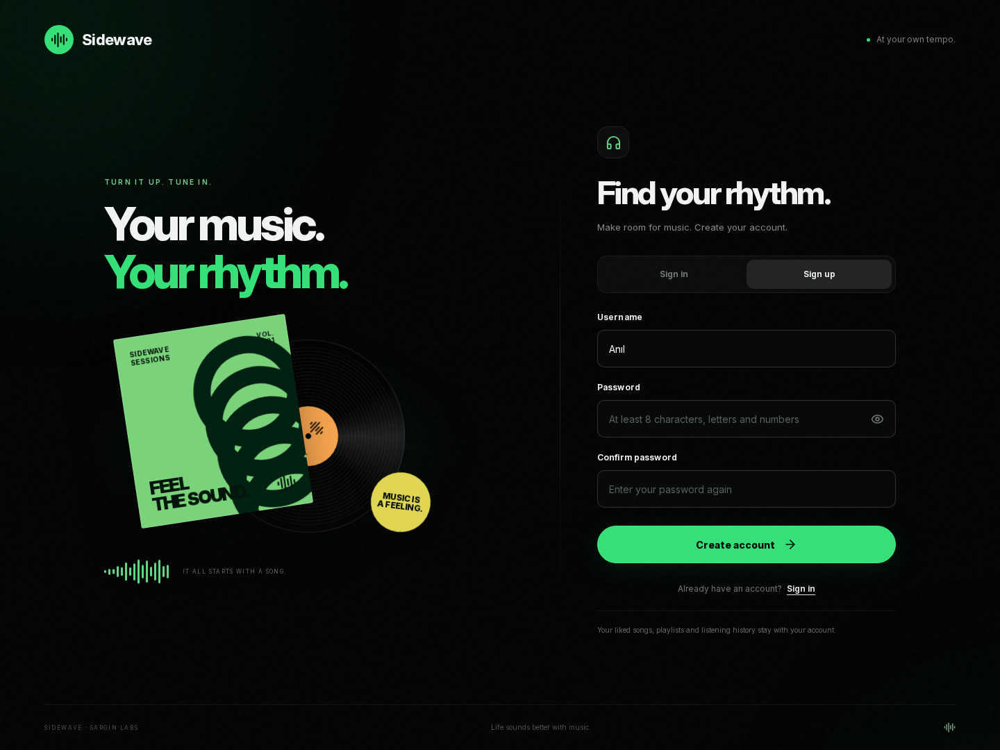<br><strong>Make room for music</strong><br>Create an account with its own likes, playlists and listening history.</td>
  </tr>
</table>

### Set the mood. Stay in the music.

<table>
  <tr>
    <td width="50%">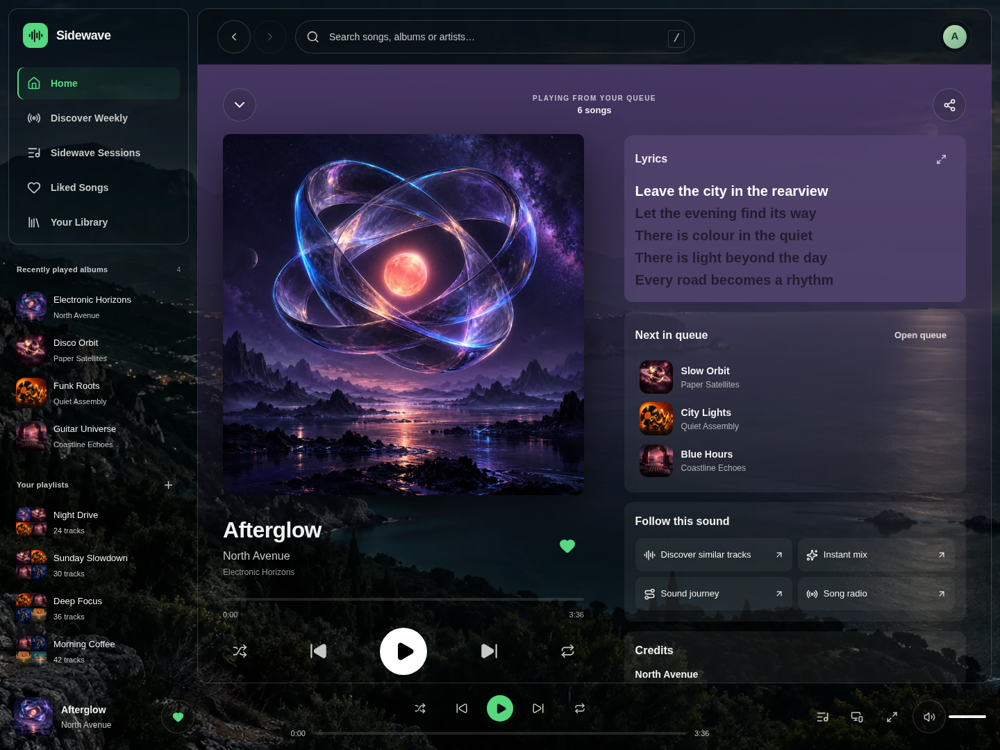<br><strong>Now Playing</strong><br>Artwork, lyrics, queue and sound discovery in one listening view.</td>
    <td width="50%">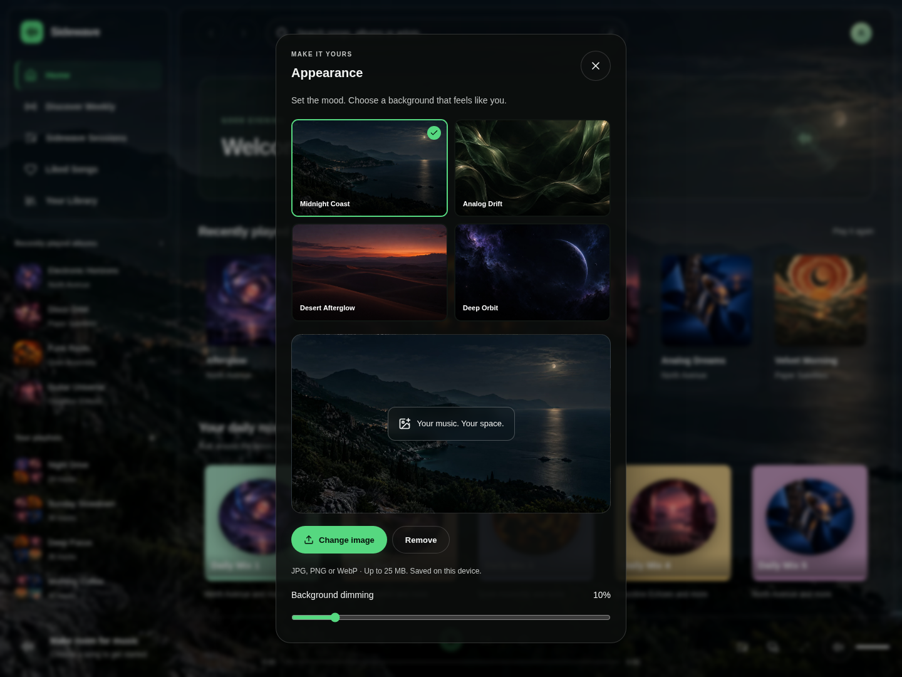<br><strong>Make it yours</strong><br>Pick a signature background or upload your own, then tune dimming and transparency.</td>
  </tr>
  <tr>
    <td width="50%">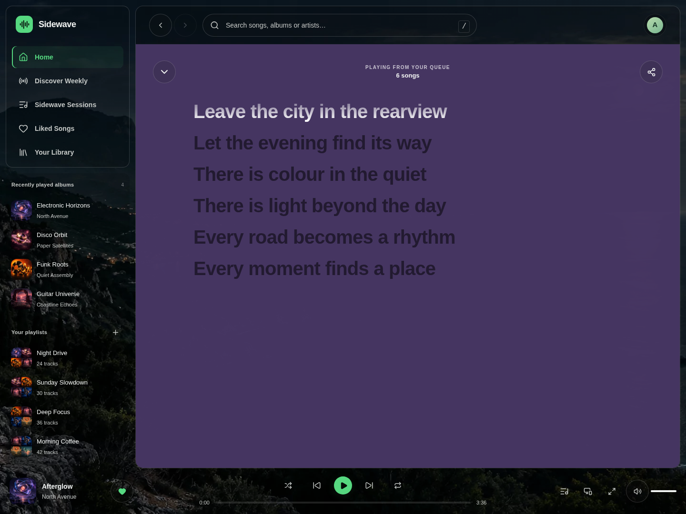<br><strong>Follow every line</strong><br>Expand synced lyrics and select a line to seek through the recording.</td>
    <td width="50%">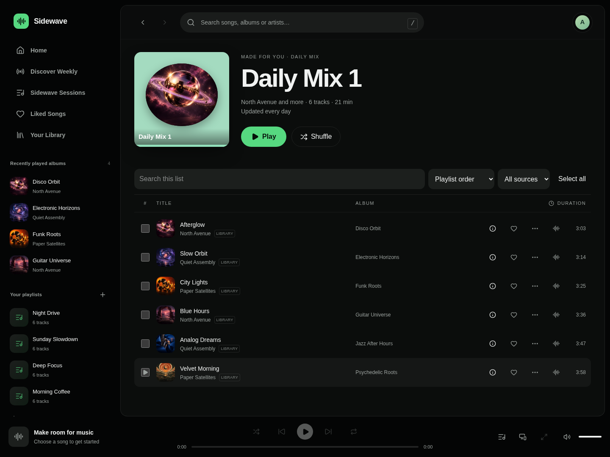<br><strong>A mix for the moment</strong><br>Artist-led daily mixes with familiar tracks and room to explore.</td>
  </tr>
</table>

<details>
<summary><strong>See a Sound journey between two tracks</strong></summary>

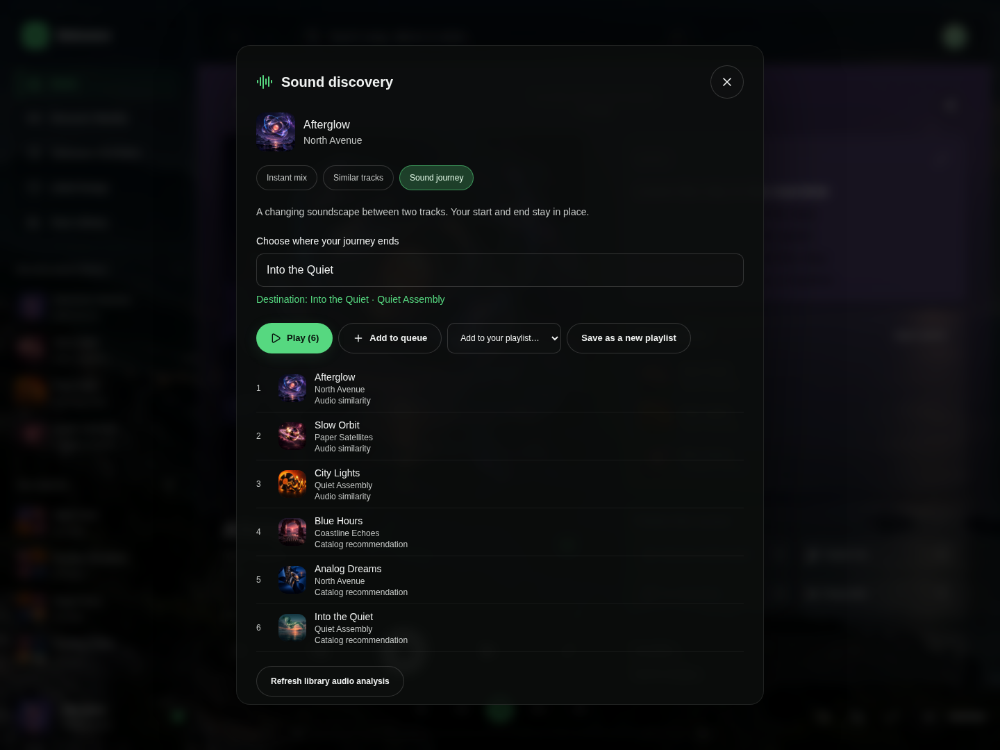

Choose the destination, preview the route, and save the journey as a playlist. Requires analyzed library recordings.

</details>

### In your pocket

<p align="center">
  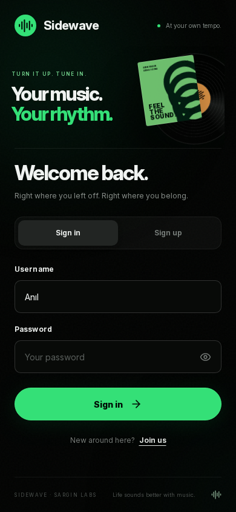
  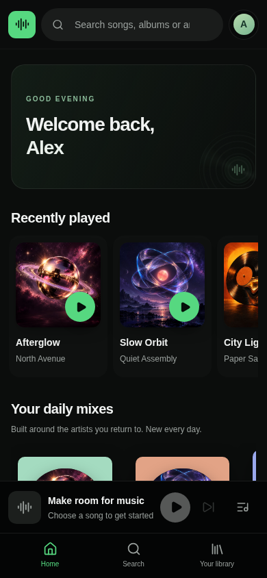
  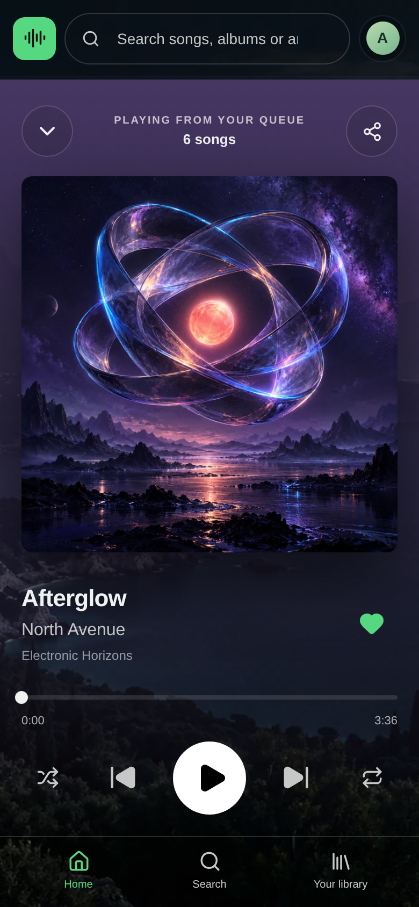
</p>

These are the responsive **mobile web** screens. Sidewave also includes a separate native Kotlin/Compose Android app with phone downloads, widgets and Android Auto support.

### In the car · Android Auto media browsing

Sidewave exposes a Media3 media library for Android Auto: **Home**, **Discover**, **Your library** and **Downloads**. Browse personal playlists, weekly discoveries and completed phone downloads, then use the shared player's transport, favourite, shuffle and repeat controls. Voice search searches metadata saved on the phone.

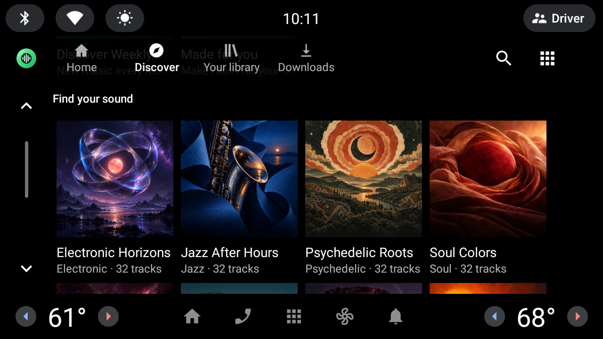

<table>
  <tr>
    <td width="50%">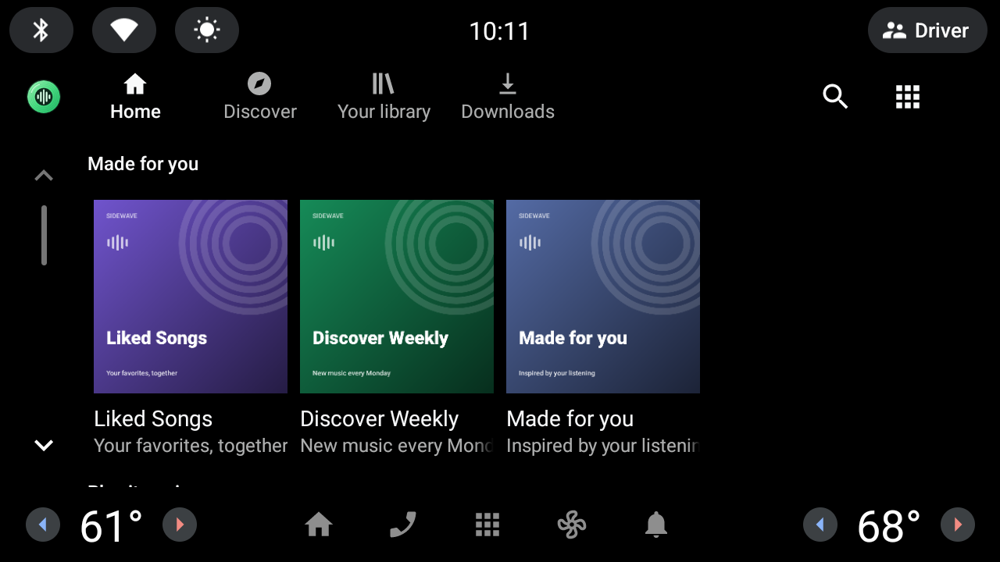<br><strong>Your music at a glance</strong><br>Quick access to liked songs, weekly discovery and personal recommendations.</td>
    <td width="50%">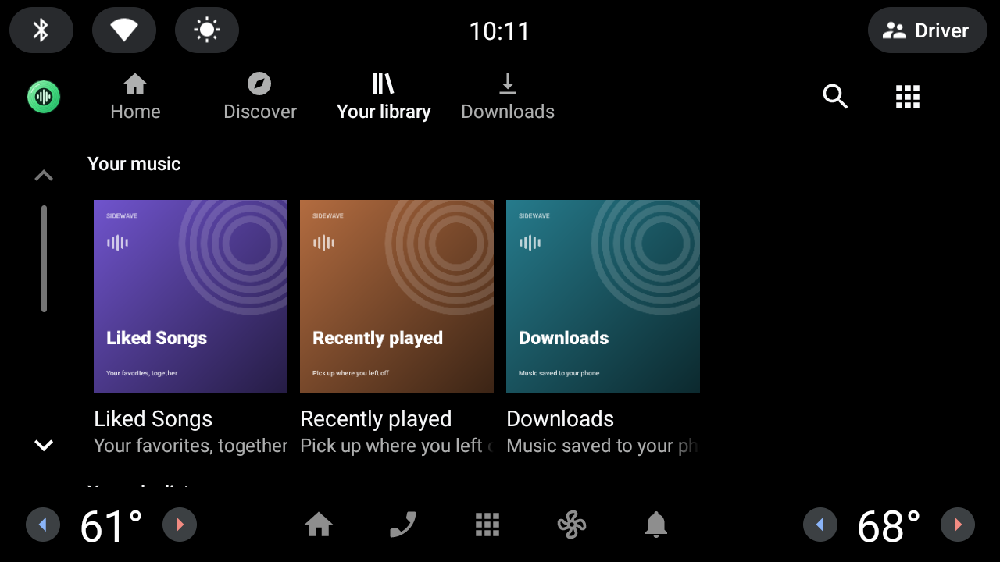<br><strong>Your library</strong><br>Personal playlists, recently played music and phone downloads.</td>
  </tr>
  <tr>
    <td width="50%">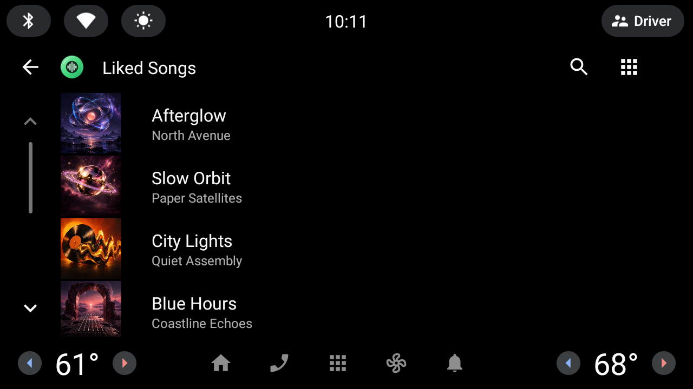<br><strong>Browse the recordings</strong><br>Cover art, song titles and artists in the host's media list.</td>
    <td width="50%">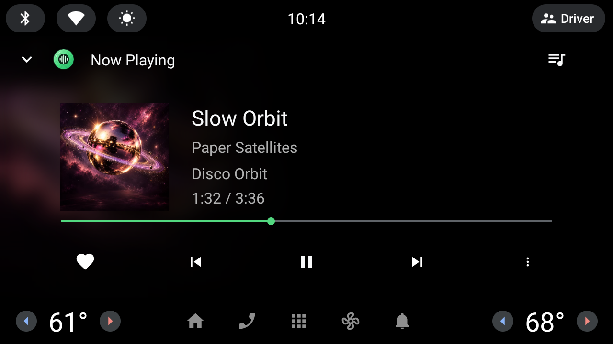<br><strong>Keep listening</strong><br>The same playback service, with controls rendered by the car media host.</td>
  </tr>
</table>

<sub>Car screenshots show Sidewave's shared media browser in an <strong>Android Automotive OS 13 emulator</strong>, using the debug preview harness and sample library. Projected Android Auto and vehicle interfaces can look different. These images do not establish physical-car or audible-playback acceptance.</sub>

<sub>Captured from the actual interfaces with a demo account named Anıl, fictional tracks, original sample lyrics and bundled artwork. Discovery results and scores are illustrative fixtures. The tour uses silent sample audio.</sub>

## Start with Docker

Requires Docker Engine and Docker Compose v2 or newer.

```sh
cp .env.example .env
mkdir -p library
docker compose up -d --build
```

Open **http://localhost:4444** and create an account. The first account owns this installation. Complete that step before making it publicly reachable.

The default setup starts the web app, API and internal catalog/resolver service. A local music library is optional. Catalog access and playback depend on the provider and network; a healthy server does not guarantee access to a specific recording.

### Connect your library

Put your own music in `library/`, then start the optional Navidrome service:

```sh
docker compose --profile library up -d
```

Open `http://localhost:4533`, create your Navidrome account and let the library scan. Set `NAVIDROME_USER` and `NAVIDROME_PASS` in `.env`, then run `docker compose up -d sidewave`. If you already have Navidrome, set `NAVIDROME_URL` to an address reachable from the Sidewave container instead.

See [self-hosting](docs/self-hosting.md) for HTTPS, storage, backups and optional integrations.

## Android

The native client requires **Android 10+**. Configure your own server at the login screen under **Connection settings**:

- A public server: `https://music.example.com`
- A local server: `http://YOUR_SERVER_LAN_IP:4444`

Sidewave has its own application ID, `com.sarginlabs.sidewave`. It installs separately from Sargın Music and does not inherit its accounts, downloads or signing identity.

```sh
cd sidewave/android
./gradlew :app:testDebugUnitTest :app:assembleDebug
```

Build requirements: JDK 17 and Android SDK 35. The resulting debug APK is under `app/build/outputs/apk/debug/`. [Android setup, signing and update publishing](sidewave/android/README.md).

## Development

Use Node.js 22 and Python 3.12 for the resolver.

```sh
cd sidewave
npm ci
npm test
npm run generate:models
cd web
npm ci
npm test
npm run build
```

Run the API with `npm start` from `sidewave/`. Run `npm run dev` from `sidewave/web/`; its API proxy defaults to `http://127.0.0.1:4444` and can be overridden with `SIDEWAVE_API_URL`.

```sh
cd ytres
python3 -m venv .venv
.venv/bin/pip install -r requirements-dev.txt
.venv/bin/python -m pytest -q
```

`sidewave/openapi.json` is the shared API contract. `npm run generate:models` updates the TypeScript and Kotlin models together. See [CONTRIBUTING.md](CONTRIBUTING.md) for checks and contribution scope.

## Project layout

| Directory | Purpose |
| --- | --- |
| `sidewave/` | Hono API, SQLite stores, contracts and backend tests |
| `sidewave/web/` | React / TypeScript web client |
| `sidewave/android/` | Kotlin / Compose / Media3 client |
| `ytres/` | Internal catalog and audio-resolution service |
| `sonic-online/` | Optional bounded audio-analysis worker |
| `beets/` | Optional library-ingestion helper |
| `docs/` | Self-hosting and release documentation |

## Project status

Sidewave is an early public-source release. The [validation report](docs/VALIDATION.md) records the automated checks and remaining manual acceptance. The [0.1.0 download](https://github.com/anilsarginn/sidewave-music/releases/tag/v0.1.0) includes a development APK; use your own signing key for a lasting Android installation. External catalogs, audio and lyrics depend on the configured providers and network.

## License and attribution

Original Sidewave code is available under the [MIT License](LICENSE). Bundled fonts, icons, dependencies and optional service images retain their own licenses; see [THIRD_PARTY_NOTICES.md](THIRD_PARTY_NOTICES.md).

Sidewave is an independent project by Sargın Labs. It is not affiliated with Spotify, YouTube, Google, Navidrome, or other products and artists using the Sidewave name.
